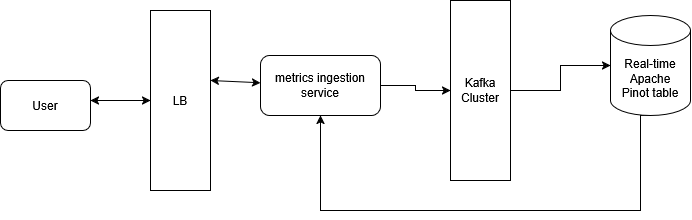

# System Design Workspace

## Problem Prompt
Design a Distributed Metrics Monitoring & Alerting System (like Datadog or Prometheus at scale) capable of ingesting 
10 million time-series metrics per second from hundreds of thousands of servers, powering real-time dashboards with
arbitrary time-range queries, and triggering alerts within 30 seconds of threshold breaches.

---
## Candidate Solution

### FR
1. System should support writing counter metric
2. System should trigger alerts upon threshold breaches
3. System should display collected metric counter through a dashboard like qps
4. Assuming DAU of 1M users
5. Assuming 1 counter metric having sample size of 1KB

### NFR
1. p99 read latency: 500 ms
2. qps write = 10 M
3. SLA: 99.9%
4. write heavy system
5. choosing high throughput over low latency
6. choosing high availability over high consistency

### Capacity Estimation
> Daily Ingestion = QPS * 86400 
- 10*10^6 * 86400 = 864 billion metrics
> Yearly Ingestion = Daily * 365
- 864*10^9 * 365 ~= 315 Trillion metrics
> Dashboard read qps = DAU / 86400 
- 10^6/86400 ~= 12 qps
> Daily Storage = daily_ingestion * per_metric_size
- 864*10^9 * 10^3 B = 864 TB
> Yearly Storage = 365 * daily storage
- 864*10^12 * 365 = 315 PB
> Network Ingress Bandwidth = Daily Storage (B)/ 86400 s
- 864 * 10^12 / 86400 = 10 GB/s

### APIs and tables
>APIs
>write API
- POST /ingest_metric?type=counter

>read API
- GET /metrics?type=counter&name={metric_name}&start_time={start_time}&end_time={end_time}&tag={tag}

> Table 
- metrics(id: PK, name: PK, timestamp: CK, tags, value)
  - B-tree index on tags
- dashboard(id: PK, name, x_time, y_value)
  - B-tree index on name
- alerts(id: PK, name, rule, trigger_time)

### Data Flow
1. metrics-ingestion service start ingesting metrics from the user
2. the service produce metrics as events into kafka cluster through dedicated topic named metrics
3. An Apache pinot real_time table named metrics is created over kafka topic metrics
4. All produced events start showing up in apache pinot
5. metrics ingestion service read data by quering apache pinot real-time table and send to client
6. Users can create dashboard on collected metrics through metrics-ingestion service.
7. dashboard table data is calculated by the service and pushed into kafka topic dashboard-ingestion and consumed into apache pinot real-time table named dashboard
8. alerts are also similarly handled by metrics-ingestion service like metrics and dashboard.

### Architecture Diagram

### Deep Dives

>Deep Dive 1: 10M/s (10 GB/s) Ingestion & Hot Partitioning:
How do hundreds of thousands of servers avoid 10M individual HTTP requests/sec (agent batching, compression, protocol),
and how do you partition Kafka so high-volume metrics don't create hot partitions?

- We can partition metrics topic by name to hot partitioning.
- Clients can start batching and compress the http requests for metrics ingestion to save on network bandwidth.
- Metrics ingestion service can even serialise metric events in avro binary format and start producing them into kafka 
and same can be processed by the Apache Pinot cluster

>Deep Dive 2: 315 PB/yr Storage, Downsampling & Multi-Month Queries:
How do you avoid storing 315 PB/yr of raw data and scanning billions of rows for a 30-day dashboard query
(time-series compression, rollups/downsampling, hot/cold tiers)?

- To solve storage issue, multiple steps that can be taken are:
  - Time series compression of raw metric data
  - Storing the aggregated data into 1s table, 60 1s table entries will form 1m table, 60 1m table entries will form 1h table
    - metrics_in_secs(id: PK, name: PK, timestamp_in_sec: CK, aggregated_tags, aggregated_values)
    - metrics_in_mins(id: PK, name: PK, timestamp_in_min: CK, aggregated_tags, aggregated_values)
    - metrics_in_hours(id: PK, name: PK, timestamp_in_hour: CK, aggregated_tags, aggregated_values)
  - Splitting the metric data into hot and cold tiers. hot data means can last 1 month into apache pinot and rest in cold storage like data lakes.

> Deep Dive 3: Alerting Within 30 Seconds:
Design the Alerting Engine: how rules (e.g., cpu > 90% for 5 mins) are evaluated within 30s 
(stream processing vs. scheduled queries), deduplicated to prevent alert storms, and dispatched.

Insights => rule evaluation via stream processing or scheduled Pinot queries, state/deduplication to prevent alert storms, notification dispatch)
- We can have a dedicated alerting-service to register alerting rules
- We can use scheduled pinot queries to evaluate alerts set in the dashboard
- alerting-service will send notification through kafka topic notifications which will send it to endpoints using SMS,IVR,email.
- alerting-service will maintain states like ALERT_PENDING, ALERT_TRIGGERED, NOTIF_SENT
  - only when state is ALERT_TRIGGERED, then notifications are sent and state is changed to NOTIF_SENT. This will prevent duplicate notification dispatch and storm
