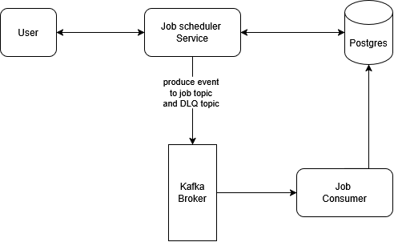

# System Design Workspace

## Problem Prompt
Design a distributed job scheduler (similar to distributed cron / delayed task execution) capable of scheduling and
executing up to 10 million delayed or recurring jobs per day with at-least-once execution guarantees and sub-second
scheduling precision.

---

## Candidate Solution

### Functional Requirements

1. Given a job, it schedules and execute the said job later on
2. Covers one-time scheduled job and recurring cron job
3. Adding job retries with exponential back-off in case of failure with base delay of 5s
4. Max retry count for failing job is 3 and then moved to DLQ
5. Assuming avg daily jobs as 10% of 10M peak jobs daily
6. Assuming per job meta data as 10 KB

### Non Functional Requirements
1. CAP - CP system i.e. high consistency to ensure at-least-once guaranty
2. SLA - 99.99%
3. p99 latency - 500 ms

### Capacity Estimation

> QPS (throughput)
1. peak QPS:
2. 10 * 10^6 ops / 86400 sec ~= 125 ops/sec 
3. avg QPS: 1 * 10^6 / 86400 sec ~= 12 ops/sec

> Storage
1. 1 day = peak QPS * per_job_meta_data * 86400
2. 1 day = 125*10KB*86400 = 10^7 * 10KB ~= 0.1 TB
3. 1 year = 365 * 0.1 TB = 36.5 TB
4. 10 year = 36.5TB * 10 = 365 TB

### APIs and data flow
> APIS
1. POST /submit_job
2. PUT /update_job(job_id)
3. GET /job?job_id=
4. DELETE /job?job_id=

> Tables
1. Enum job_type: ONE_TIME, RECURRING
2. Enum job_status: SCHEDULED, IN_PROGRESS, FINISHED, DELETED, FAILED, DLQ
3. jobs(job_id: str PK, user_id: str FK, job_type: str, meta_data: json, cron_expression: str)
   a. PK is job_id, B-tree indexes on job_type
4. job_executions(execution_id PK, job_id: FK, scheduled_time, job_status, retry_count, next_retry_at, lease_timeout_at)
   a. B-tree indexes on (job_status, scheduled_time)
5. users(user_id: str, name: str)
   a. PK is user_id

> Data flow
1. Client will use Rest APIs to send delayed and recurring jobs to the job scheduler service.
2. job scheduler saves data in jobs table in postgres
3. job scheduler calculates scheduled time for both job_types and store it scheduled_time in job_execution table
4. for job_type=RECURRING, job scheduler will re-calculate the next scheduled time after parsing cron expression when last execution finishes
5. job scheduler produces jobs to kafka broker in jobs topic
6. job_scheduler picks up failed jobs through an hourly cron using query - Select job_id from job_execution where job_status = 'FAILED'
7. 3 max_retries are done on the failed job with next_retry_at calculated using formula now + base_delay * 2^retry_count
8. After all retries are exhausted then job scheduler pushes the data to DLQ kafka topic to be processed later on using 
   query = select job_id from job_execution where job_status = 'DLQ'
9. To prevent midnight thundering, we will need to horizontally scale postgres and kafka.
   a. shard postgres using user_id as key
   b. increase partition of kafka topics in odd numbers
10. To prevent job execution loss in kafka consumer if job failed when being processed, we will resort to manual offset commit, so that job will be picked up again during topic partition rebalancing
11. kafka topic partition key will be job_id
12. to prevent multiple schedulers from claiming same job, we can append to queries FOR UPDATE SKIP LOCKED;
    a. select job_id from job_execution where job_status = 'SCHEDULED' and scheduled_time <= now() FOR UPDATE SKIP LOCKED;
13. job_scheduler will produce data using exactly-once-semantics i.e. ACK(all)
14. for RECURRING jobs, job scheduler will have a min_heap which will store data as (scheduled_time, job_id) and when min_heap.top() <= now(), top is popped from min_heap and job_id is produced to kafka.

### Architecture Diagram

### Deep dive

> Deep Dive 1
Sub-second Triggering & Avoiding Duplicate Dispatch: If multiple scheduler/poller nodes watch for due jobs,
how do you prevent two nodes from dispatching the same job twice?

- sub-second triggering: kafka job topic partition key will be the job_id for all jobs.
- The recurring job can be produced to kafka cluster using exactly-once-semantics i.e. ACK(ALL) at producer level
- For scheduled or recurring jobs, we can use an in-memory min-heap which stores data as (scheduled_time, job_id) 
  - it will poll every second and try to check if job_id matches the condition min_heap.top() <= now()
  - then pop the tuple and fetch job from jobs table using job_id and produce it to kafka cluster with ACK(ALL)
- avoiding duplicates among multiple schedulers: A jobScheduler will look for job from job_execution table using an atomic DB claim. 
  - query will be: select job_id from job_executions where job_status = 'SCHEDULED' FOR UPDATE SKIP LOCKED;. followed by
  - second query: update job_executions set job_status = 'IN_PROGRESS' where job_id = {job_id};

> Deep Dive 2
Deep Dive 2: At-Least-Once Execution & Worker Crash Recovery
Suppose a Consumer/Worker marks a job IN_PROGRESS and crashes mid-execution. How does the system detect the stuck job and re-schedule it?
Also explain how next_retry_at is tracked for exponential backoff (so retry_count <= 3 isn't retried immediately in a tight loop).

- Job scheduler will produce message to kafka cluster with exactly once semantics i.e. ACK(all), which means that producer only waits for all topic partitions to send back ACK.
- We can change kafka consumer group offset from auto-commit to manual commit.
  - This will ensure that the message will be delivered to another consumer on topic rebalancing/recovery
  - next_retry_at will be calculated as now + base_delay*(2^retry_count)
  - the next_retry_at will be stored in jobs postgres table.
- if a job scheduler claims a job and fails before producing to kafka then
  - first we will fetch rows using query: select job_id from job_executions where job_status = 'IN_PROGRESS' and lease_timeout <= now()
  - second, we will mark them 'SCHEDULED' using query: update job_executions set job_status='SCHEDULED' where job_id={job_id}

> Deep Dive 3
Midnight Thundering Herd: If 100K+ cron jobs all have scheduled_time = 00:00:00, how do your Scheduler, Postgres,
and Kafka Consumers absorb that burst without blowing your < 1s precision or crashing downstream targets?

- We can horizontally scale our systems
  - shard our postgres database using key = user_id
  - increase partitions of kafka topics jobs and dlq in odd number
- We can introduce priority ordering of non-immediate task
- Per user, we can introduce rate-limiting as well.

    