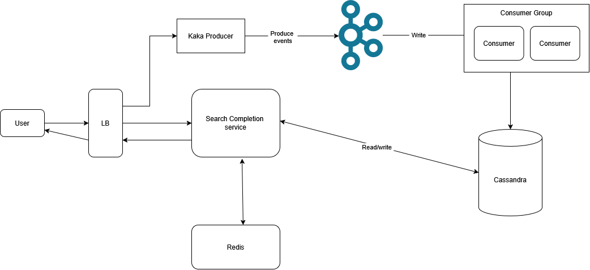

# System Design & Architecture Workspace

## Problem Statement
Design a real-time **Search Autocomplete (Typeahead) System** (similar to Google Search suggestions) that returns the top $K$ most relevant or popular query completions as a user types each character into a search box. The system must support hundreds of millions of daily active users with sub-100ms suggestion latency while continuously updating query popularity from live search traffic.

---

## Candidate Solution & Notes
*(Write your requirements, back-of-the-envelope capacity estimations, API design, data structures/storage schema, high-level architecture, and trade-offs below.)*

## Requirements

### Functional
1. Given a search term, top print k items
2. I am assuming k to 5
3. Assuming 10 searches per user per day
4. Assuming minimum 3 characters typed before generating recommendations

### Non Functional
1. Highly available or AP based system
2. sub-100ms latency for type ahead

## Back of the envelope capacity estimations
Throughput (QPS)

- DAU is 100 Million active users
- QPS = DAU * searches_per_user_per_day * minimum_chars_typed_per_search
- QPS = 10^8 * 10 * 3 = 3*(10^9)/86400 qps
  - Assuming 86400 ~= 9 * (10^4)
  - 35k min QPS and 100k max QPS
- Assuming each service in a horizonal scaled system could handle 1000 qps.
- So we will need at least 100k/1000 ~= 100 type-ahead service.

Capacity
- Capacity per query is 1*3 = 3 byte for 3 chars.
- for 5 suggestion it will be 15 byte
- for 10^5 qps it will be 10^5 * 5 byte = 500KB
- for a day, it will be 3600 sec, so 3600*500KB ~= 2000MB * 24 = 48000MB ~ 50000MB ~= 50GB
- for a year, it will 400*50GB = 20 TB
- for 5 year horizon, we will need 100 TB storage atleast and then moved to archive (cold storage)

## Data structures
1. we can use redis(SortedSets) for caching 5 recommendations per keyword
2. We can have a Recommendation generation service that can process trending search queries.
3. Any wide column DB like Cassandra or DynamoDB or Google Bigtable can be used

## Trade off
1. We are choosing high availability over strong consistency
2. assuming only 5 suggestion per query to save on storage and to be under sub 100 ms.

## API design
- GET /search?query=iph&country=India&city='Delhi' -> return top 5 recommendations
- POST store_query(analytics_event_stream) -> body will contain raw click event

## Data Model

> Tables
- clicks_global_counter(country, city, prefix, click_counter, suggestion) PK is (country,city,prefix), clustering key is click_counter desc
- user_search_queries(user_id, query, timestamp)

We need to store prefix and top 5 suggestions in redis
- key as prefix_{country}_{city}_{prefix} and
- score as click_counter
- values as suggestions
- retrieving the top 5 suggestions command is `zrevrange prefix_{country}_{city}_{prefix} 0 4`

This task will be done by Search Completion Service on Cache miss.

## Architecture

