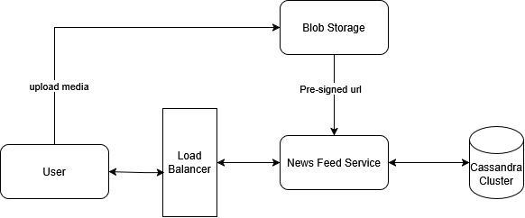

# System Design Workspace

## Problem Prompt
Design a News Feed system (like Twitter / X or Facebook Feed) serving 300 million Daily Active Users (DAU).
Users can publish posts (text and media), follow other users (including celebrities with tens of millions of followers),
and fetch their personalized home timeline in real time with low latency.

---

## Candidate Solution

### Functional Requirements
1. Users can create, edit, see their posts in home feed
2. Users can follow other users
3. Generating news feed for all users
4. Users news feed will be posts from their followers
5. Users can comment on any post
6. Assuming 10% of 300M DAU as avg online users ~= 30 M
7. Assuming users post an avg of 10 posts daily
8. Assuming each post size be 10 KB containing only text and media

### Non Functional Requirements
1. SLA: 99.99%
2. All APIs p99: 500ms
3. CAP -> AP: High Availability

### Capacity Estimations
1. peak write QPS:
   a. 300*10^6 * 10 / 86400 ~= 35K qps
2. avg write qps:
   a. 30*10^6 * 10/ 86400 ~= 3.5K qps
3. read qps:
   a. Assuming each DAU fetches feed 10 times a day
   b. avg read qps = DAU * 10 / 86400 = 300*10^6/86400 ~= 35K qps
   c. peak read qps ~= 100k qps
4. capacity
   a. 1 day = 30M * 10* 10KB = 3*10^12 i.e 3 TB
   b. 1 year = 365 * 3TB = 1095 TB ~= 1.1 PB

### API and Data Models
>APIs
1. POST /create_user
2. PUT /user?id=
3. GET /user_profile?id=
4. POST /create_post
5. PUT /post?id=
6. DELETE /post
7. GET /home_feed?user_id=
8. GET /news_feed?user_id=
9. POST /user_follow
10. PUT /user_follow
11. GET /followers?user_id=

>Tables
Choosing cassandra cluster as primary database
1. user(user_id: PK, name, created_at, updated_at, bio, profile_pic_thumbnail_url, profile_pic_url)
2. post(post_id: PK, user_id, content, created_at, updated_at, media_thumbnail_url, media_url)
3. home_feed(user_id:PK, post_updated_at: Clustering key, desc, post_id)
4. news_feed(user_id: PK, post_updated_at: Clustering key desc, post_id)
5. post_comment(post_id: PK, comment_id: Clustering Key)
6. comments(comment_id: PK, created_at: PK, content)
7. user_followers(user_id: PK, follower_id: PK)
8. user_following(user_id: PK,following_id: PK)

### Data flow
Everything is abstracted out and done by News Feed Service
1. We register users.
2. Users can follow other users on the platform. We store them in the user_followers table
3. Users start seeing their followers post on their home feed.
4. When a user creates/edit a post.
   a. we register the post on the home feed table
   b. we fetch all their followers from user_followers table.
   c. We can fan-out and register this post in the news_feed table of all the followers.
5. Users can comment on all posts. It will be stored in comments and post_comments table and added to the author's and author's followers feed.
6. Media(text/picture) can be uploaded/downloaded to a separate blob storage.
   a. NFS fetches a pre-signed url from blob-storage and passes it to client.
   b. Client then upload media async through pre-signed_url.

### Architecture

### Deep Dives
>Deep Dive 1: Celebrity Problem & Async Fan-Out: How do you decouple fan-out asynchronously and handle normal 
> users vs. celebrities (50M+ followers) without timing out POST /create_post or writing 50M rows per celebrity post?

- instead of writing posts directly through NFS service, it can be decoupled through kafka cluster
- API will post event to kafka topic named feed, fanout-on-write for normal users.
- Threshold will be 35k followers per user that will do fan-out-write to feed table in cassandra.
- For celebrity, we will fan-out-write only for 35k, in news_feed table.
- we will create a new table celebrity_posts(user_id: PK, post_updated_at: CK, post_id: int)
- When user opens feed, then we will also fetch from celebrity_post table in addition to news_feed table.
- The kafka consumer will async process feed event and write the post in each follower's feed table.

>Deep Dive 2: Low-Latency Timeline Reads, Caching & Pagination:
How do you cache hot timelines and post objects so GET /news_feed stays well under 500ms p99 at massive read QPS, 
and how do you handle cursor pagination?

- We can use dedicated RedisCache to cache the user's feed into memory.
- We also cache hot read post and user entries in cassandra table in the redis cache with TTL of 10 mins
- When kafka consumer write to a user's cassandra news feed table, it will also write to Redis cluster with 10 mins TTL.
- We will create feed for multiple pages, i.e. minimum 10 pages in advance through kafka consumer and cache the result page_wise in Redis using SortedSets
  - Sorting in Redis ZSET will be done on the basis of last_seen_timestamp.
  - Once post_id is fetched by NFS service, We hit the redis cache for user's feed's post_ids. In case of cache miss, we will hit cassandra's post and user table
- Get /news_feed will provide us with page_no along with last_seen_timestamp during API calls to prevent fetching duplicate posts.
- This will reduce load on cassandra reads for GET /news_feed and we can achieve under 500ms p99.

>Deep Dive 3: Media Pipeline & Real-Time Delivery:
Walk through the upload/read path for media (images/video) and how newly published posts appear in real time

- NFS fetches a pre-signed url from blob-storage
- Client receives the above pre-signed url and start uploading media.
- Once uploaded, the blob-storage produce an event to kafka cluster.
- Then, the event is processed by kafka consumer generates thumbnail for the media (image/video)
- Thumbnail is uploaded by the NFS and CDN urls for thumbnail and media is then saved in cassandra table.

