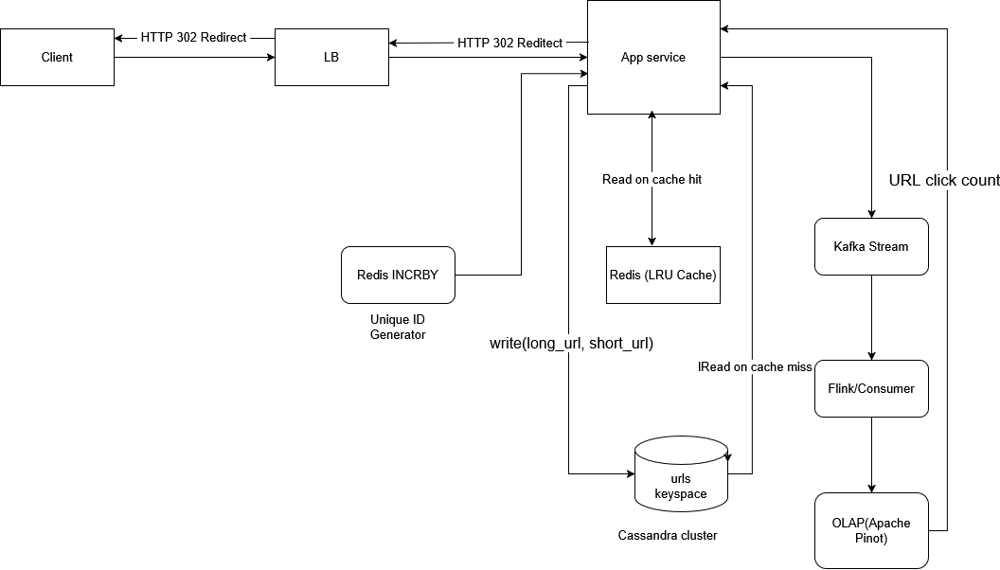

# Tiny URL

## Functional Requirements
- shorten(long_url) -> return alias 
- redirect(alias) -> 302 HTTP Redirect to original URL
- analytics -> click count

## Non Functional Requirments
- scale to 1 Million URL

## Design

- Traffic Ratio: Read-heavy
- Read-write ratio: 100:1
- CAP Priority: High availability & Partition tolerance
- Latency SLA: <50 ms with 99.99% availability for Redirects
- Data Retention: 5 years default
- Storage layer: NoSQL - Key Value DB (Cassandra)
    - Partition key: short_url

### Table Design

```sql
create table urls(
    short_url text
    long_url text,
    created_at TIMESTAMP,
    expiration_time TIMESTAMP   
)
```
7 bits = base62 chars - [a-zA-Z0-9]  = ~62^7
base64 chars - [a-zA-Z0-9+/]

>How will you generate short_url from long_url?
- Hashing long_url using SHA-256 and taking first 7 chars -> this will need collision resolution
- Distributed 64 bit (8 byte) ID generator using key-generation, and then convert to 62 bit -> zero collisions
- Key generation service which will use pre-generated keys and store unused keys in database - much better solution with Relational Databases

> Data pipeline
- Unique int64 id generator -> base62 string

> Process (int to base 62)
1. Client sends /shorten_url(long_url) -> short_url
2. App generates unique id in base10 (like 100, 215 etc.) and convert it into base62 str
3. We convert int64 value (which is int in python) to base62 string using divmod
4. long_url and short_url is saved in urls table

```python
from typing import List
alphabet = "abcdefghijklmnopqrstuvwxyzABCDEFGHIJKLMNOPQRSTUVWXYZ0123456789"

def base10_to_base62(num: int) -> str:
    if num==0:
        return alphabet[0]
    chars = []
    while num:
        num, rem = divmod(num, 62)
        chars.append(alphabet[rem])
    return "".join(reversed(chars))

def nums_to_base62(nums: List[int]) -> str:
    if len(nums) != 4:
        print("required 4 ints")
        return ''
    short_url =  "".join(base10_to_base62(num) for num in nums)
    return f"www.tinyurl.com/{short_url}"
```

>How to generate ID?
Approach A: 10 to 11 character short_url
- Use snowflake unique id generator.
- it generates id locally in RAM without network calls

Approach B: strict 7 character
- Use Range based global counter (coordinated by zookeeper,etcd, or Redis INCRBY)
- coordinator tracks a global counter from 56.8B(62^6) to 3.5T(62^7)
- when app server runs out of id, it ask the coordinator for next 100,000 chars
- app server increments local counter in memory


## Architecture Design




