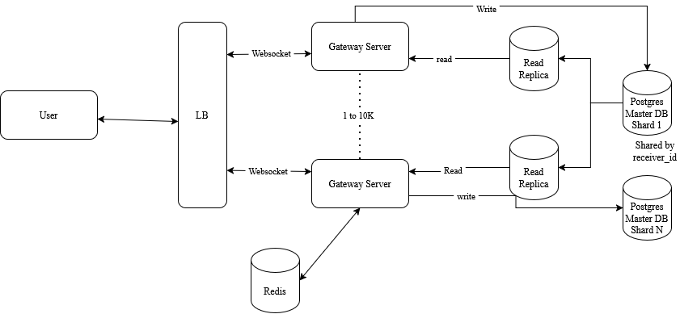

# System Design Workspace

## Problem Prompt
Design a real-time instant messaging system like WhatsApp or Facebook Messenger serving 500 million Daily Active Users (DAU).
The system must support 1-on-1 chats, group chats (up to 500 members), offline message delivery when a user reconnects,
and online/last-seen presence status.

---

## Candidate Solution

### Functional Requirements
1. system should support 1-on-1 chat
2. system should support group chat for up to 500 members
3. offline message delivery
4. online or last seen presence status
5. Chat will support text message with max size of 1 KB
6. we will need to support message receipts - sent, delivered and read
7. We will not store chat history, only queued till delivered. 
8. We will that per user will send at max 10 message daily and on average 5 message daily
9. we will that max store for 1 day for the text message

### Non Functional Requirements
1. High consistency for message delivery
2. DAU - 500 million
3. SLA requirement - 99.99% availability
4. p99 delivery latency  - 500ms

## Capacity estimations
>Peak QPS
1. Formula = DAU* max_user_messages_daily/86400
2. 5*10^8 * 10/ 86400 ~= 57.8 * 10^3 = 57.8k qps ~= 60k qps
3. qps = 60K qps

> Avg QPS
1. Formula = DAU* avg_user_messages_daily/86400
2. avg qps = 30k qps

>Storage
1. Storage = QPS * 1KB * 86400
2. 60*10^3 * 10^3 B * 86400 = 5.184 * 10^12 ~= 5TB

>Websockets
1. per server can support 50k websockets concurrently
2. DAU = 500 million
3. Assuming 10% persistent connections
3. no of gateway server needed = DAU * percent_persistent_connection/per_server_capacity
4. which is (5*10^7 * 0.1)/50k = 1k gateway servers

>Network Egress/Ingress
1. Message size = 1KB
2. Ingress = DAU * 10% persistent connections * 1 KB
3. which is 50M * 1KB = 50 GB
4. Egress = DAU * 10% persistent connections * 1 KB + DAU * 1% persistent group chat connections * 500KB
5. which is 50 GB + 2.5 TB = 3 TB

### APIs / DataModels
1. Websocket /chat(sender_id, receiver_id)
2. Websocket /group_chat(sender_id, group_id)
3. Tables - 
   a. users(id: int, name: str, group_ids: List[int])
   b. user_groups(group_id:int, user_id:int)
   c. message(receiver_id:int, sender_id:int, message_timestamp: timestamp, message: text, sent: bool, delivered: bool, received: bool)
4. Redis DataModel
   a. Online Presence -> key: presence_{user_id}; value: last_seen_timestamp;
   b. Websocket connection -> key: websocket_{user_id}; value: gateway_server_id; TTL:60 sec 

### Architecture Diagram



### Deep Dives

> Deep Dive 1: Real-Time Cross-Gateway Routing (1-on-1 Chat)

```text
Suppose User A is connected to Gateway-1 and sends a message to User B, who is connected to Gateway-2:

What component/store tracks which Gateway Server currently holds User B's WebSocket, and how is it updated on connect/disconnect?
How does Gateway-1 deliver the message to Gateway-2 in real time (< 500ms p99) without polling Postgres read replicas?
What happens if Gateway-2 crashes or User B disconnects right as the message is in flight?
```

1. We can use Redis to store which gateway server contains a connected user's websocket connection having TTL of 60 secs
   a. having TTL on user's websocket connection will prevent connection to stale websocket 
   b. for 50M persistent connections, we require to send heartbeat at-least per 25 sec. so 50M/25 sec = 2M Redis writes per sec.
   c. heartbeat will involve overwriting websocket gateway server_id for each connected user.
2. for real-time messaging between users in 2 different servers, user A send message to gateway server
   and then we find out from Redis user B gateway server i.e B, and server A will send message to server B
3. communication between gateway servers will happen using gRPC.
4. if any gateway server crashes, client can connect through LB to other gateway servers.

> Deep Dive 2: Storage Scaling, Ordering & Offline Delivery
```text
Deep Dive 2: Storage Scaling, Ordering & Offline Delivery

Your MVP uses a single Postgres Master + Read Replicas for 60K+ peak QPS and 5 TB/day of queued messages:

How will you shard/partition your message store (and what partition/sort keys will you use) to eliminate the single-master write bottleneck while supporting fast reads on reconnect?
How do you guarantee strict message ordering (e.g., if User A sends M1 then M2 milliseconds apart)?
Walk through the exact reconnect & ACK flow for offline delivery: how are pending messages fetched, delivered, acknowledged, and expired/deleted after 1 day without losing messages on a client crash?
```

1. We will shard the master Postgres database using shard key as receiver_id
   a. So that when a user reconnects we can query its pending queued message be delivered from a given shard properly
2. To ensure distributed chat system's message ordering guarantee, 
   a. we can use snowflake int64 id generator
   b. this will be appended to each message to ensure message uniqueness and avoid millisecond collision between 2 servers

>Deep dive 3:
Deep Dive 3: Group Chat Fan-Out (500 Members) & Presence at Scale
Group Fan-Out: User A sends a message to a 500-member group where 300 members are online (across ~200 gateways) and 200 are offline. How do you decouple ingestion from fan-out so Gateway-1 doesn't block, and how do you handle offline queueing and receipts for 500 recipients?
Presence (ONLINE / OFFLINE / last_seen): With 50M concurrent users sending heartbeats, how do you store presence without overloading your primary DB, detect abrupt disconnects (dead battery / lost signal), and avoid a broadcast storm to all friends on every status change?

`Presence`
1. We can use a distributed Redis cluster.
2. Based on the data model above, presence will online/offline based on whether key: websocket_{user_id} exists or not.
3. Similarly, user's last seen timestamp can be fetched from key: presence_{user_id}
4. This information will be collected regularly from 50 M persistent connection through every 25 sec.
5. Throughput will be 50M ops/25 sec = 2M writes qps 

`Group Chat Fan-Out`
1. Sender_id will fetch group members or receiver_ids from user_groups using query
   a. select group_id, user_id as receiver_id from user_groups
2. for each receiver_ids check whether the redis key: websocket_{receiver_id} exists or not. This will determine online/offline
3. for online users, after fetching receiver gateway_server_id, message will be sent.
4. for offline users, we will write to messages table with sent as True and delivered and seen as False
5. when offline users come back online, we will fetch the messages using query 
   a. query - select message, message_timestamp from messages where receiver_id = {receiver_id} and sent = True and delivered = False
6. once messages are seen and message table is updated, a hourly cron can delete the seen messages or at higher scale, messages can be deleted asynchronously
