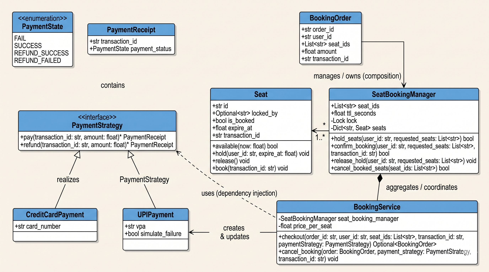

# Functional Requirements

## User journey that we will be supporting

1. How to handle concurrent users booking same seat
   a. Seat hold using TTL
2. checkout and payment integration
3. booking cancellation and refund

# Implementation

1. [main.py](main.py)

# Class Diagram

1. 